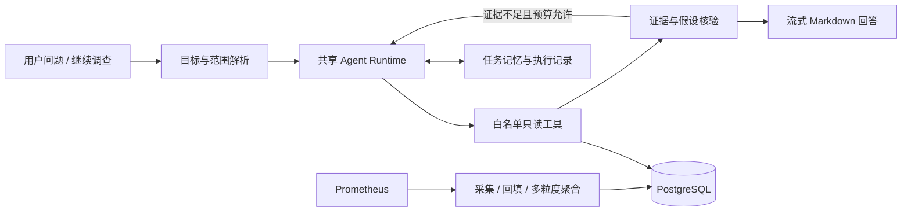

<div align="center">
  
  <h1>Resource Ops Agent</h1>
  <p><strong>资源观测 · 证据调查 · 决策辅助</strong></p>
  <p>面向 Kubernetes GPU 集群的资源运营平台与只读调查 Agent</p>
  <p><a href="#-快速开始">快速开始</a> · <a href="docs/IMPLEMENTATION.md">实现说明</a> · <a href="docs/OPERATIONS.md">操作与部署</a></p>
</div>

## 🎯 项目解决什么问题

资源数据散落在不同集群和监控面板中，单看显存分配或一张利用率曲线，很难回答“资源发生了什么变化”“数据是否可信”“还需要查什么”。

本项目将 **Prometheus 采集、PostgreSQL 历史分析和受控 Agent 调查**连接起来：先统一资源口径，再逐步收集证据、核验解释，输出可追溯的分析结果。项目从 GPU Resource Center 演进而来，目前同时覆盖 GPU 节点的 CPU、系统内存及普通容器资源。

## ✨ 可以做什么

| 入口 | 主要能力 |
| --- | --- |
| 🏠 工作台 | 资源规模、GPU 零显存占用、实际使用、集群状态与关注项 |
| 🖥️ 资源资产 | 服务器 / GPU 两个视图，配置、CPU/内存/负载、利用率、温度和历史下钻 |
| 🧩 业务模型 | 显式归属映射、类别和版本搜索、关联 Pod 与 GPU |
| 🔎 分析中心 | 多资源历史、自然语言资源助手、变化诊断、占用调查及任务记录 |
| 📐 资源规划 | GPU 显存额度初筛、历史风险与候选方案对比 |
| 📋 运营中心 | 人工触发报告、指标关注项、调查与运营问题关联 |
| 📊 数据与运行 | 同步覆盖、运行评估、PV/UV/DAU、功能及 Agent 任务统计 |

可以从这些问题开始：

> 两个机房总体服务器配置如何？
>
> 为什么近三个月 CPU 历史不完整，是否还没有回填？
>
> 分配率上升来自业务增长，还是总容量变化？
>
> GPU 分配较高但利用率较低，还存在哪些解释？

## 🖼️ 页面与项目演示

页面PDF使用经授权的真实历史快照并脱敏，数据截至时间见水印；不是当前实时状态，导出不触发采集、资源变更或新的模型调用。

**[项目介绍演示稿 · 10页 PDF](assets/project-overview.pdf)**

[工作台](assets/screenshots/01-workbench.pdf) · [服务器](assets/screenshots/02-servers.pdf) · [GPU资产](assets/screenshots/03-gpus.pdf) · [历史分析](assets/screenshots/04-history.pdf) · [资源助手](assets/screenshots/05-assistant.pdf) · [资源规划](assets/screenshots/06-planning.pdf) · [使用统计](assets/screenshots/07-usage.pdf)

## 🧠 Agent 系统设计

复杂问题进入有预算的调查循环，简单事实查询和确定性额度评估直接复用领域服务。



- **动态查证**：组合快照、历史、覆盖、同步检查点及业务贡献工具，不把固定回答模板当成推理。
- **证据核验**：数值、引用、单位和归因边界由服务端复核；缺测与冲突保留未知。
- **任务记忆**：持久化目标、对象、已查证据和待办；继续时重新取证、继承或收窄范围，任务链最多4轮。
- **执行控制**：工具白名单、参数校验、并发与轮次预算、超时、取消、幂等和失败回退。
- **自然语言交付**：模型组织 Markdown 正文，事实占位符由后端展开，按段流式返回；证据和执行过程按需展开。
- **可对照评测**：提供规则、Single-shot、Agent 三组评测，保留冻结任务与失败轨迹；不把核验器收益算成多轮模型收益。

实现入口：[Runtime](backend/app/agents/runtime.py) · [组合工具](backend/app/agents/registry.py) · [证据核验](backend/app/agents/verification.py) · [任务记忆](backend/app/agents/memory.py) · [评测](backend/app/agents/evaluation.py)

## 🛠️ 技术栈与工程取舍

| 层次 | 实现 |
| --- | --- |
| 前端 | React 19、TypeScript、Vite、本地 CSS/SVG、Markdown 渲染 |
| 后端 | Python 3.11+、FastAPI、Pydantic、httpx |
| 数据 | Prometheus HTTP API、PostgreSQL、Psycopg |
| 模型 | DeepSeek API，经服务端最小化数据后调用 |
| 验证 | Pytest、Playwright、Ruff、mypy、合成对照评测 |

采用单实例、服务分层架构。采集与页面读取分离，历史按分钟、5分钟和小时管理；保留均值所需统计、极值、有效采样数与覆盖率。当前不引入 Redis、Celery、向量库或多 Agent 编排框架。

## 🚀 快速开始

需要 Python 3.11+、Node.js 22+ 和 npm。基础 Mock 演示不需要 GPU、企业内网或模型密钥。

```bash
python -m venv .venv
.venv/bin/pip install -r backend/requirements.lock
.venv/bin/pip install -e './backend[dev]'
if [ ! -f .env ]; then cp .env.example .env; fi
npm ci --prefix frontend
npm run build --prefix frontend
./scripts/start-backend.sh
```

访问 **http://127.0.0.1:17979**。已有 `.env` 会继续使用；全新环境默认 Mock。确认使用 Mock 时，可将 `.env` 中两项显存单位设为 `MB`、`ALLOCATION_ABSENCE_IS_ZERO` 设为 `true`；Live 必须核验源端语义后再配置。

完整历史、资源助手、调查记录和使用统计需要 **PostgreSQL 14+**。本机实例、Docker、采集开关及 DeepSeek 配置见[操作手册](docs/OPERATIONS.md)。模型调用还需有效密钥和数据处理授权。

## 🧪 验证与能力边界

核心逻辑支持离线 Mock 测试；数据库测试使用可丢弃的独立库，浏览器覆盖正常流程、缺测、故障、内网 HTTP 和移动端。Agent 评测区分开发 / 留出、原始模型输出 / 核验结果，当前合成小样**尚未证明多轮 Agent 优于强规则基线**，不声称已完成生产泛化验收。

HAMi 已分配量是**虚拟显存额度**，不等于物理显存占用。零显存占用不保证可调度，低利用率也不能单独证明浪费。系统不提供 Shell、SSH、kubectl 或资源变更工具；对外部署仍需企业认证、TLS 和权限验收。

## 📚 继续了解

- [实现说明](docs/IMPLEMENTATION.md)：服务边界、数据模型、指标口径、Agent、评测与当前限制。
- [操作与部署](docs/OPERATIONS.md)：配置、启动、迁移、历史维护、测试和生产验收。
- [开发约束](AGENTS.md)：数据真实性、隐私、只读工具和代码维护约定。
